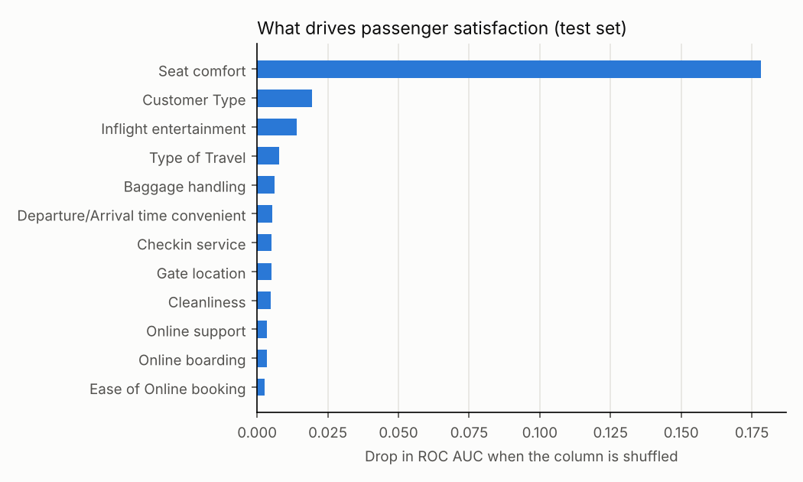

# Airline passenger satisfaction: classifier and service drivers

Predicts whether a passenger is satisfied from a 130,000-row airline survey, and ranks which services matter most. I rebuilt this from my M.Sc. Data Analytics coursework (Predictive Analytics and Machine Learning using Python, BSBI, 2024).

The original assignment asked which parts of the service an airline should fix first. I answered it with one random forest and reported 99% accuracy. When I rebuilt it, I found that the 99% came from using only the first 23,616 rows of the file, which are easier to classify than the rest. On the full data the same model reaches 95.5%. The details are in [docs/coursework-review.md](docs/coursework-review.md).

## Results

Shuffled, stratified 60/20/20 split. The model was chosen on the validation set and the test set was used once.

| Model | Accuracy | Precision | Recall | F1 | ROC AUC |
|---|---|---|---|---|---|
| Logistic regression | 82.8% | 84.1% | 84.5% | 84.3% | 0.903 |
| Random forest | 95.3% | 96.5% | 94.8% | 95.7% | 0.992 |
| **Gradient boosting** (chosen) | **95.5%** | **96.9%** | **94.9%** | **95.9%** | **0.994** |

The gap between logistic regression and the tree models comes mostly from ratings that do not have a straight-line effect (see seat comfort below).

## What drives satisfaction



Permutation importance on the test set: how much ROC AUC drops when one column is shuffled.

| Rank | Feature | AUC drop | Cumulative share |
|---|---|---|---|
| 1 | Seat comfort | 0.178 | 66% |
| 2 | Customer type (loyal or not) | 0.020 | 74% |
| 3 | Inflight entertainment | 0.014 | 79% |
| 4 | Type of travel | 0.008 | 82% |
| 5 | Baggage handling | 0.006 | 84% |

Seat comfort dominates, but part of that is a quirk in the data. Passengers who rated it 0 (not rated) were 99.8% satisfied, the same as those who rated it 5. Ratings 1 to 3 sit at 36% to 45%. So the model learns two things from this column: a real effect of comfort, and the meaning of a blank answer.

A second view that does not depend on a model: for each service, the share of low ratings (1-2) among dissatisfied passengers minus the share among satisfied ones.

| Service | Low ratings, dissatisfied | Low ratings, satisfied | Gap |
|---|---|---|---|
| Inflight entertainment | 43.7% | 8.3% | 35.4 pts |
| Ease of online booking | 42.7% | 11.7% | 31.0 pts |
| Online boarding | 41.9% | 13.1% | 28.9 pts |
| Online support | 37.4% | 13.0% | 24.4 pts |
| On-board service | 35.8% | 13.2% | 22.6 pts |

What I would tell the airline: fix seat comfort for the middle ratings and inflight entertainment first. Then look at the digital journey (online booking, boarding and support), which is where dissatisfied passengers stand out most.

## Run it

The data is the Kaggle data set *Airlines Customer satisfaction* (file `Invistico_Airline.csv`). It is not included here; see [data/README.md](data/README.md).

```bash
pip install -e ".[dev]"
python -m airline_satisfaction --data data/Invistico_Airline.csv   # about 40 seconds
python -m airline_satisfaction --sample                              # generated data, no download
pytest
```

Results go to `reports/` (`results.md`, CSV tables, chart).

## Layout

```
src/airline_satisfaction/
    data.py      load, column checks, quality report, split, fake sample for tests
    model.py     logistic regression, random forest, gradient boosting; selection on validation
    drivers.py   permutation importance, rating gaps, row-order check
    __main__.py  runs everything and writes reports/
reports/         results on the full Kaggle file
docs/            coursework review
tests/           8 tests, run on generated data in CI
```

## License

Code: MIT. The data belongs to its publisher on Kaggle and is not redistributed here.
