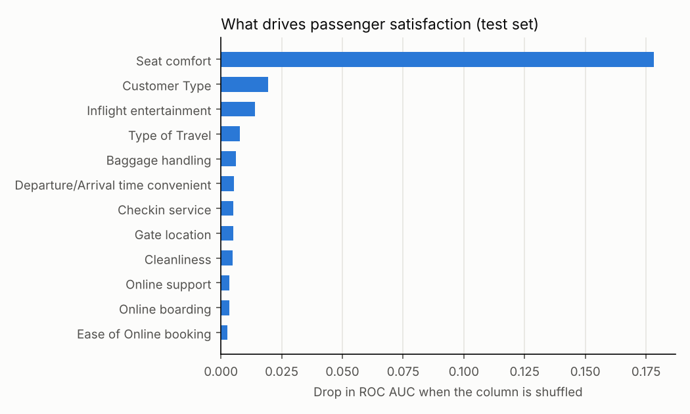

# Results

Data: Invistico_Airline.csv, 129,880 rows, 55% satisfied. Split 60/20/20, stratified, seed 42.

## Data checks

- Missing values: 393 in arrival delay (filled with the median inside each model).
- Duplicate rows: 0.
- Departure and arrival delay correlation: 0.965.
- Share of 0 ratings (read as "not rated"): Seat comfort 3.7%, Departure/Arrival time convenient 5.1%, Food and drink 4.6%, Gate location 0.0%, Inflight wifi service 0.1%, Inflight entertainment 2.3%, Online support 0.0%, Ease of Online booking 0.0%, On-board service 0.0%, Leg room service 0.3%, Checkin service 0.0%, Cleanliness 0.0%, Online boarding 0.0%.

## Model choice (validation set)

| model | accuracy | precision | recall | f1 | roc_auc |
|---|---|---|---|---|---|
| gradient_boosting | 0.9568 | 0.9696 | 0.9508 | 0.9601 | 0.994 |
| random_forest | 0.9549 | 0.9675 | 0.9494 | 0.9584 | 0.9929 |
| logistic_regression | 0.8305 | 0.846 | 0.844 | 0.845 | 0.9034 |

Chosen by ROC AUC: **gradient_boosting**.

## Test set (used once)

| model | accuracy | precision | recall | f1 | roc_auc |
|---|---|---|---|---|---|
| logistic_regression | 0.8275 | 0.8409 | 0.8446 | 0.8427 | 0.9029 |
| random_forest | 0.9532 | 0.9654 | 0.9484 | 0.9569 | 0.992 |
| gradient_boosting | 0.9554 | 0.9686 | 0.9493 | 0.9588 | 0.9935 |

## Drivers of satisfaction

| feature | auc_drop | cumulative_share |
|---|---|---|
| Seat comfort | 0.1781 | 0.664 |
| Customer Type | 0.0195 | 0.737 |
| Inflight entertainment | 0.0141 | 0.79 |
| Type of Travel | 0.0078 | 0.819 |
| Baggage handling | 0.0062 | 0.842 |
| Departure/Arrival time convenient | 0.0053 | 0.862 |
| Checkin service | 0.0051 | 0.881 |
| Gate location | 0.0051 | 0.9 |
| Cleanliness | 0.0047 | 0.918 |
| Online support | 0.0036 | 0.931 |

## Where dissatisfied passengers rate low

| service | low_share_dissatisfied | low_share_satisfied | gap |
|---|---|---|---|
| Inflight entertainment | 0.437 | 0.083 | 0.354 |
| Ease of Online booking | 0.427 | 0.117 | 0.31 |
| Online boarding | 0.419 | 0.131 | 0.289 |
| Online support | 0.374 | 0.13 | 0.244 |
| On-board service | 0.358 | 0.132 | 0.226 |
| Checkin service | 0.355 | 0.141 | 0.214 |
| Seat comfort | 0.51 | 0.297 | 0.212 |
| Leg room service | 0.367 | 0.16 | 0.207 |

## Row-order check

| data | rows | satisfied_share | test_accuracy |
|---|---|---|---|
| first 23616 rows | 23616 | 0.505 | 0.9888 |
| random 23616 rows | 23616 | 0.551 | 0.9426 |
| all rows | 129880 | 0.547 | 0.9554 |

| feature | first_rows_mean | other_rows_mean |
|---|---|---|
| Inflight entertainment | 2.88 | 3.5 |
| Seat comfort | 2.33 | 2.95 |
| Age | 38.36 | 39.66 |
| Flight Distance | 1797.71 | 2022.24 |
| Arrival Delay in Minutes | 15.68 | 14.96 |

| rating | zero_share_first_rows | zero_share_other_rows |
|---|---|---|
| Seat comfort | 0.071 | 0.029 |
| Departure/Arrival time convenient | 0.035 | 0.055 |
| Food and drink | 0.09 | 0.036 |
| Inflight entertainment | 0.053 | 0.016 |

## Satisfaction by Seat comfort rating

| Seat comfort | satisfied_share | passengers |
|---|---|---|
| 0 | 0.998 | 4797 |
| 1 | 0.451 | 20949 |
| 2 | 0.358 | 28726 |
| 3 | 0.356 | 29183 |
| 4 | 0.652 | 28398 |
| 5 | 0.992 | 17827 |
